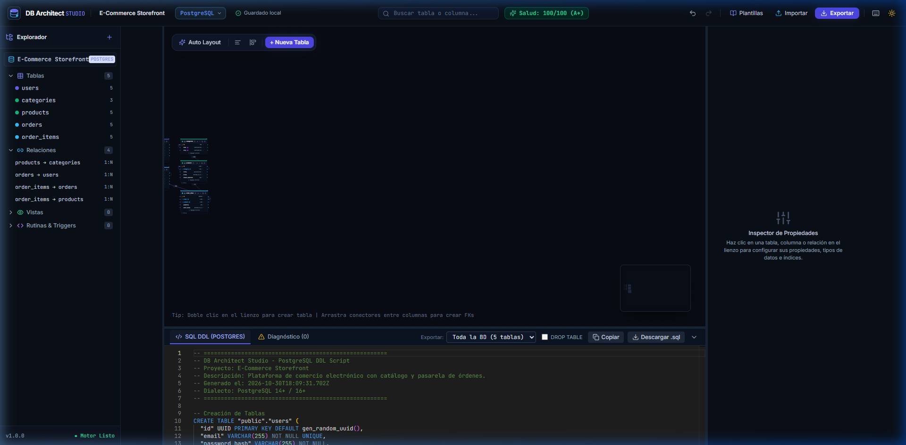
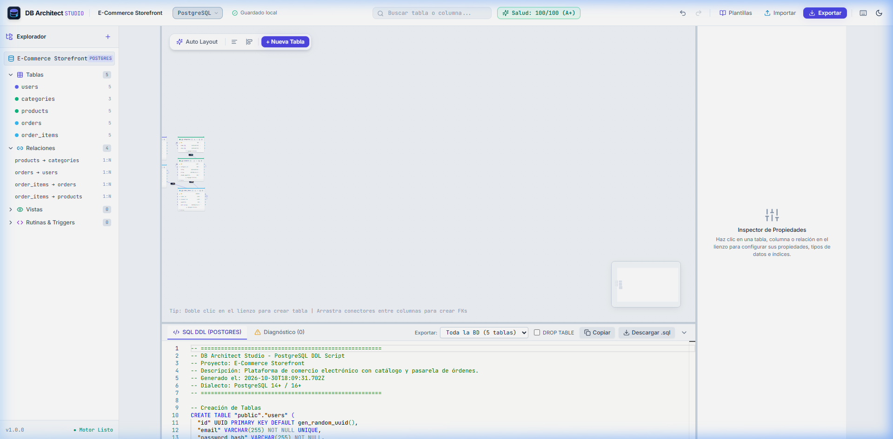
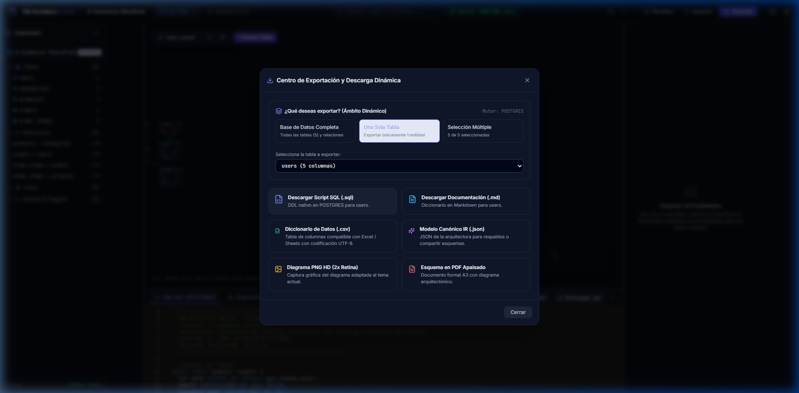
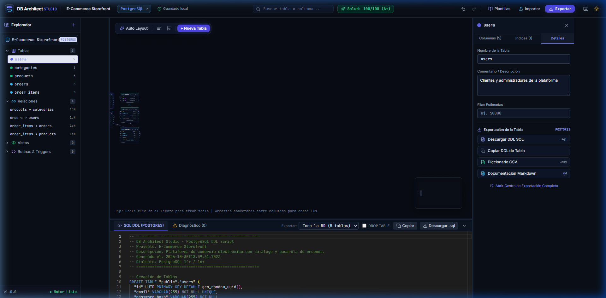
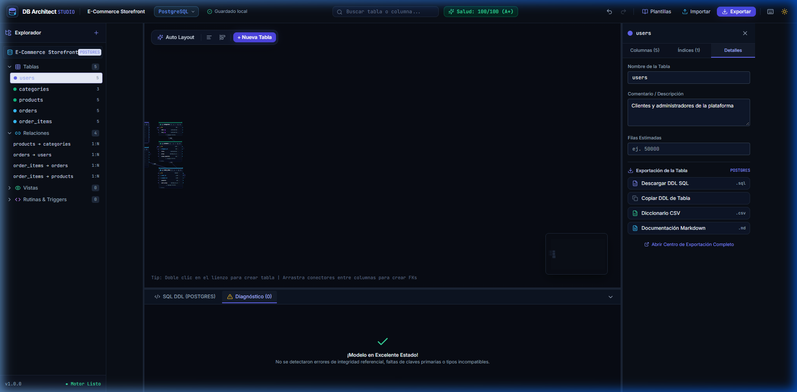

# DB Architect Studio
### Plataforma Profesional de Modelado Visual, Documentación y Administración de Bases de Datos


**DB Architect Studio** es una plataforma integral de ingeniería visual de bases de datos que permite a arquitectos de software, desarrolladores y DBAs diseñar, modelar, validar, documentar y generar estructuras SQL relacionales complejas en tiempo real mediante una experiencia gráfica moderna, fluida y de nivel comercial.

Inspirada en el refinamiento visual y la ergonomía de **Figma**, **Linear** y **VS Code**, la herramienta combina un lienzo interactivo a 60 FPS con sincronización bidireccional inmediata, compiladores DDL multi-motor nativos (PostgreSQL, MySQL y SQLite), motor de diagnóstico de salud del esquema con auto-corrección en 1 clic y exportación dinámica granular.

---

## 📸 Galería Visual

| Modo Oscuro (Producción) | Modo Claro (Documentación) |
| :---: | :---: |
|  |  |

| Centro de Exportación Dinámica | Editor SQL Monaco en Vivo con Filtro |
| :---: | :---: |
|  |  |

| Diagnóstico de Salud con 1-Click AutoFix | Inspector de Tablas y Exportación Rápida |
| :---: | :---: |
|  |  |

---

## 📚 Documentación del Proyecto

El proyecto cuenta con documentación técnica exhaustiva en español dentro de la carpeta [`/docs`](docs/):

- 📖 **[Manual de Usuario Completo](docs/MANUAL_USUARIO.md):** Guía detallada de uso, gestión de tablas, trazado de relaciones, atajos de teclado y exportación.
- 🚀 **[Guía de Instalación y Puesta en Marcha](docs/GUIA_INSTALACION.md):** Requisitos, comandos paso a paso para Windows, Linux y macOS, y solución de problemas.
- 🏛️ **[Arquitectura Técnica y Sintaxis DDL](docs/ARQUITECTURA_Y_SINTAXIS.md):** Explicación del modelo canónico IR, sistema de tipos, algoritmo de Kahn y sintaxis SQL generada por motor.

---

## 🌟 Características Destacadas

### 1. Modelado Visual e Interactivo
- **Lienzo Infinito:** Zoom inteligente fluido (20% a 250%), desplazamiento panorámico y cuadrícula magnética.
- **Nodos de Tabla Personalizados:**
  - Paleta de 7 colores para agrupar módulos y dominios.
  - Puertos de conexión independientes por columna.
  - Distintivos visuales para Claves Primarias (🔑 PK), Claves Foráneas (🔗 FK) y Unicidad (⚡ UQ).
  - Acciones rápidas en cabecera: **descarga directa de DDL**, duplicar tabla, colapsar y eliminar.
- **Conectores Bézier Dinámicos:**
  - Relaciones visuales entre columnas (1:1, 1:N, N:M).
  - Líneas continuas para relaciones identificadoras y discontinuas para no identificadoras.
  - Reglas referenciales configurables: `ON DELETE` y `ON UPDATE` (`CASCADE`, `SET NULL`, `RESTRICT`, `NO ACTION`).

### 2. Exportación Dinámica y Granular
El sistema permite trabajar de manera **completamente no estática**:
- **Ámbitos Disponibles:** Exporta **toda la base de datos**, **una sola tabla** o una **selección personalizada** de tablas.
- **Puntos de Descarga Inmediata:**
  - Botón de descarga directa en la cabecera de cada tabla en el lienzo.
  - Sección de exportación rápida en la pestaña "Detalles" del Inspector.
  - Icono de descarga al pasar el cursor sobre cualquier tabla en el Explorador lateral.
  - Selector de ámbito en el panel inferior del editor SQL.
  - Centro de exportación principal con soporte para:
    - **Script SQL (.sql):** DDL nativo optimizado.
    - **Documentación Markdown (.md):** Diccionario técnico listo para GitHub o Notion.
    - **Diccionario CSV (.csv):** Compatible con Microsoft Excel con codificación UTF-8 BOM.
    - **Modelo JSON (.json):** Respaldo de la arquitectura relacional.
    - **Imágenes PNG HD (2x Retina) y Vectores SVG.**
    - **Documento formal en PDF Apaisado (A3).**

### 3. Compiladores SQL Multi-Motor y Encabezados de Auditoría
Arquitectura desacoplada basada en una Representación Intermedia (IR) con soporte para **5 motores relacionales líderes**:
- **PostgreSQL 14+ / 16+:** Esquemas, comillas dobles, `SERIAL`/`BIGSERIAL`, `UUID`, comentarios `COMMENT ON` y constraints `ALTER TABLE`.
- **MySQL 8.0+ / MariaDB:** Backticks, `AUTO_INCREMENT`, `ENGINE=InnoDB DEFAULT CHARSET=utf8mb4` y directivas preventivas `SET FOREIGN_KEY_CHECKS = 0/1;`.
- **SQLite 3:** Claves foráneas obligatorias en línea (`inline`) dentro del `CREATE TABLE`, soporte para `AUTOINCREMENT` y `PRAGMA foreign_keys = ON;`.
- **Microsoft SQL Server (2019 / 2022 / Azure SQL):** Dialecto T-SQL con corchetes `[dbo].[tabla]`, tipos `NVARCHAR`/`DATETIME2`, claves agrupadas `PRIMARY KEY CLUSTERED`, extended properties `sys.sp_addextendedproperty` y directivas `SET ANSI_NULLS ON / GO`.
- **Oracle Database (19c / 21c / 23c):** Dialecto PL/SQL corporativo con identificadores entrecomillados en mayúsculas `"TABLA"`, tipos nativos `NUMBER`, `VARCHAR2(CHAR)`, `CLOB`, identidades `GENERATED ALWAYS AS IDENTITY` y comentarios nativos `COMMENT ON TABLE/COLUMN`.
- **Encabezados Descriptivos y Bloques de Auditoría:** Cada script y tabla generada incluye un banner formal con el nombre del proyecto, descripción del dominio, marca de tiempo ISO, motor relacional, resumen de columnas y claves primarias.
- **Creación de Proyectos desde Cero:** Botón dedicado **"Nuevo"** para iniciar modelos limpios con lienzo en blanco o tabla base, personalizando el título y propósito del dominio.
- **Ordenamiento Topológico (Algoritmo de Kahn):** Ordena las tablas automáticamente para que las tablas maestras se creen antes que las dependientes, aislando referencias circulares.

### 4. Schema Health Score & Auditoría en Tiempo Real
- **Puntuación de 0 a 100:** Calificación cualitativa (**A+**, **A**, **B**, **C**, **F**).
- **Reglas de Auditoría Automáticas:**
  - Detección de tablas sin clave primaria (Error crítico).
  - Detección de claves foráneas sin índice explícito (Advertencia de rendimiento).
  - Incompatibilidad de tipos de datos en claves foráneas.
  - Columnas con nombres duplicados o tablas vacías.
  - **1-Click AutoFix:** Agrega automáticamente claves primarias `id` o crea índices secundarios sugeridos con un solo clic.

### 5. Editor SQL en Tiempo Real (Monaco Editor)
- Integración nativa del motor de VS Code con resaltado de sintaxis SQL.
- Formateo reactivo milimétrico a medida que se modela en el lienzo.
- Copia al portapapeles con confirmación visual y descarga instantánea.

### 6. Ingeniería Inversa (SQL DDL Parser)
- Módulo de análisis léxico capaz de procesar scripts `CREATE TABLE` y `ALTER TABLE` de PostgreSQL, MySQL y SQLite.
- Reconstruye tablas, tipos de datos, restricciones e índices, organizándolos automáticamente en el lienzo.

---

## ⌨️ Atajos de Teclado y Gestos

| Atajo | Acción |
| :--- | :--- |
| `Ctrl + Z` / `⌘ + Z` | Deshacer última acción (Undo) |
| `Ctrl + Y` / `⌘ + Y` | Rehacer última acción (Redo) |
| `Delete` / `Supr` | Eliminar tabla o relación seleccionada |
| `Doble Clic (Lienzo)` | Crear una nueva tabla en la posición del puntero |
| `Doble Clic (Nombre)` | Renombrar tabla en línea |
| `Arrastrar Manija` | Trazar relación y generar Clave Foránea |
| `Rueda del Ratón` | Zoom interactivo del diagrama (20% a 250%) |
| `Arrastrar Fondo` | Desplazamiento panorámico (Pan) |

---

## ⚡ Instalación Rápida

### Prerrequisitos
- **Node.js** `>= 20.0.0`
- **npm** `>= 10.0.0`

### 1. Clonar e Instalar el Proyecto
```bash
git clone https://github.com/PatricioMP08/DB-Architect-Studio.git
cd DB-Architect-Studio/client
npm install
```

### 2. Ejecutar según la Modalidad Deseada

#### 🌐 Modo Aplicación Web (Navegador)
```bash
npm run dev
```
La aplicación abrirá en: **`http://localhost:5173/`**

#### 💻 Modo Aplicación de Escritorio (Desktop Nativo)
```bash
npm run electron:dev
```
Abre la aplicación como ventana nativa de escritorio de Windows/macOS/Linux con barras de menú del sistema operativo.

#### 📦 Generar Ejecutable de Escritorio (.exe para Windows)
```bash
# Genera la aplicación lista para ejecutar sin instalador en release/win-unpacked/
npm run electron:pack

# Genera el instalador profesional de Windows (.exe con NSIS)
npm run electron:build
```

### 3. Ejecutar Pruebas Automatizadas
```bash
npm run test
```

### 4. Iniciar el Servidor API (Opcional)
```bash
cd ../server
npm install
npm run dev
```

El servidor REST estará disponible en: **`http://localhost:3001`**

Para instrucciones detalladas paso a paso, consulta la [Guía de Instalación](docs/GUIA_INSTALACION.md).

---

## 🛠️ Stack Tecnológico

| Capa | Tecnologías |
| :--- | :--- |
| **Frontend Framework** | React 18, Vite 6, TypeScript 5.7 |
| **Lienzo Interactivo** | `@xyflow/react` (React Flow v12) |
| **Editor de Código** | `@monaco-editor/react` (Monaco SQL) |
| **Estado y Caché** | Zustand con almacenamiento inmutable |
| **Estilos y Diseño** | Tailwind CSS v3.4 + PostCSS, `react-resizable-panels` |
| **Iconos y Animación** | `lucide-react`, `framer-motion`, `canvas-confetti` |
| **Exportación de Archivos**| `file-saver`, `html-to-image`, `jspdf` |
| **Testing** | Vitest |
| **Plataforma de Escritorio** | Electron 41, Electron Builder (Windows `.exe` / macOS / Linux) |
| **Backend API** | Node.js, Express, TypeScript |

---

## 👨‍💻 Autor

- **Patricio Mardones** — [@PatricioMP08](https://github.com/PatricioMP08)

---

## 📄 Licencia

Este proyecto está bajo la Licencia **MIT**. Consulta el archivo `LICENSE` para más información.
