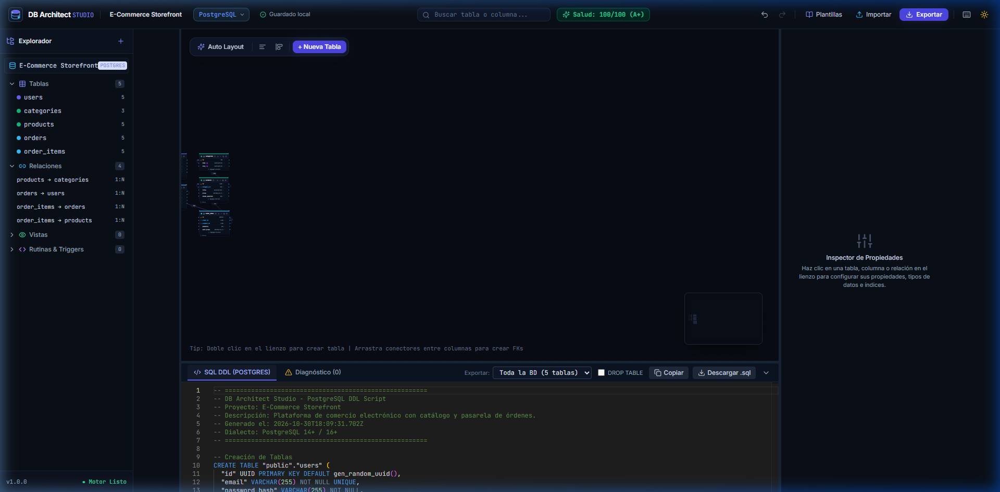

# Guía de Instalación y Puesta en Marcha

Bienvenido a la guía oficial de instalación y despliegue de **DB Architect Studio**, la plataforma profesional de ingeniería visual, modelado y administración de bases de datos relacionales.

Este manual te guiará paso a paso para configurar y ejecutar el entorno tanto en **Windows**, **macOS** como en **Linux**.

---

## 📋 1. Requisitos Previos del Sistema

Antes de comenzar, asegúrate de tener instalado en tu equipo:

| Herramienta | Versión Mínima Requerida | Comando de Verificación |
| :--- | :--- | :--- |
| **Node.js** | `>= 20.0.0` (LTS recomendada) | `node -v` |
| **npm** | `>= 10.0.0` | `npm -v` |
| **Git** | `>= 2.30.0` | `git -v` |

> [!TIP]
> Si no cuentas con Node.js instalado, puedes descargarlo de forma gratuita desde [nodejs.org](https://nodejs.org/) (selecciona la versión **LTS**).

---

## 🗂️ 2. Estructura del Proyecto

El repositorio cuenta con una arquitectura desacoplada organizada en dos capas principales:

```
db-architect-studio/
├── client/                     # Frontend SPA (React 18, Vite 6, Tailwind CSS, Monaco)
│   ├── src/
│   │   ├── core/               # Motor lógico desacoplado (IR, Compiladores SQL, Parser, Analyzer)
│   │   ├── components/         # Componentes UI (Canvas, TableNode, Inspector, Modales, etc.)
│   │   ├── stores/             # Estado global con Zustand (projectStore, historyStore, uiStore)
│   │   └── tests/              # Pruebas unitarias automatizadas con Vitest
│   ├── package.json
│   └── vite.config.ts
├── server/                     # Backend API (Express, TypeScript)
│   ├── src/
│   │   ├── routes/             # Endpoints REST (/api/health, /api/projects, /api/introspect)
│   │   └── index.ts
│   └── package.json
├── docs/                       # Documentación técnica, capturas y manuales
│   ├── images/                 # Capturas en alta definición para el repositorio
│   ├── GUIA_INSTALACION.md     # Este documento
│   ├── MANUAL_USUARIO.md       # Manual de uso de la herramienta
│   └── ARQUITECTURA_Y_SINTAXIS.md # Especificación técnica y sintaxis DDL
└── README.md                   # Presentación principal para GitHub
```

---

## 🚀 3. Instalación Paso a Paso

### Paso 1: Clonar el Repositorio

Abre tu terminal favorita (PowerShell, CMD, Git Bash o Terminal de macOS/Linux) y clona el proyecto:

```bash
git clone https://github.com/tu-usuario/db-architect-studio.git
cd db-architect-studio
```

---

### Paso 2: Instalación del Frontend (`client`)

Navega a la carpeta del cliente e instala todas las dependencias:

```bash
cd client
npm install
```

> [!NOTE]
> Esto instalará bibliotecas críticas como `@xyflow/react` (lienzo interactivo), `@monaco-editor/react` (editor SQL con sintaxis de código), `file-saver` (descargas de archivos seguras y sin pérdida de extensión), `jspdf` y `html-to-image`.

---

### Paso 3: Instalación del Backend (`server`)

En una segunda terminal o retrocediendo un nivel, instala las dependencias del servidor:

```bash
cd ../server
npm install
```

---

## 💻 4. Ejecución en Modo Desarrollo

### Iniciar el Frontend (Cliente)

Dentro de la carpeta `client/`, ejecuta:

```bash
npm run dev
```

La consola mostrará una salida similar a la siguiente:

```text
  VITE v6.4.5  ready in 925 ms

  ➜  Local:   http://localhost:5173/
  ➜  Network: http://192.168.1.100:5173/
  ➜  press h + enter to show help
```

Abre tu navegador web e ingresa a: **`http://localhost:5173/`**



---

### Iniciar el Backend (Servidor)

En otra terminal, dentro de la carpeta `server/`, ejecuta:

```bash
npm run dev
```

El servidor REST estará disponible en: **`http://localhost:3001`** con su endpoint de comprobación de salud en `http://localhost:3001/api/health`.

---

## 🧪 5. Ejecución de Pruebas Automatizadas

El proyecto cuenta con una suite integral de pruebas unitarias que valida:
1. El algoritmo de ordenamiento topológico (Kahn) y detección de dependencias circulares.
2. La generación exacta de DDL en PostgreSQL (con `SERIAL`, `COMMENT ON` y constraints).
3. La generación de DDL en MySQL (con backticks, `ENGINE=InnoDB` y `AUTO_INCREMENT`).
4. La generación de DDL en SQLite (con claves foráneas en línea y `PRAGMA foreign_keys = ON;`).
5. El analizador de salud de bases de datos (cálculo de 0 a 100 y reglas de auditoría).
6. El parser SQL de ingeniería inversa (extracción de tablas, columnas y tipos).

Para ejecutar las pruebas:

```bash
cd client
npm run test
```

Salida esperada:
```text
 ✓ src/tests/core-engine.test.ts (7 tests) 14ms

 Test Files  1 passed (1)
      Tests  7 passed (7)
   Duration  1.30s
```

---

## 🏗️ 6. Compilación para Producción (Build)

Para generar la compilación optimizada lista para desplegar en plataformas como **Vercel**, **Netlify**, **Render** o un servidor **Nginx**:

```bash
cd client
npm run build
```

Los archivos finales minificados se generarán en la carpeta `client/dist/`. Para previsualizar el bundle de producción localmente:

```bash
npm run preview
```

---

## 💻 7. Modalidad de Escritorio (Desktop Nativo)

**DB Architect Studio** está configurado para ejecutarse tanto como aplicación web como aplicación de escritorio nativa para Windows, macOS y Linux mediante **Electron**.

### A. Probar la Aplicación de Escritorio en Desarrollo
Abre el servidor Vite y lanza la ventana nativa de Electron simultáneamente:

```bash
cd client
npm run electron:dev
```

### B. Generar la Aplicación Ejecutable (.exe para Windows)
Para compilar la aplicación y generar el archivo ejecutable portátil:

```bash
cd client
npm run electron:pack
```

El ejecutable directo **`DB Architect Studio.exe`** se creará en la carpeta:
`client/release/win-unpacked/`

### C. Generar el Instalador Profesional (.exe con Asistente NSIS)
Para generar el instalador formal con acceso directo en el escritorio y menú inicio:

```bash
cd client
npm run electron:build
```

El instalador `.exe` se creará en la carpeta `client/release/`.

---

## 🛠️ 8. Solución de Problemas Frecuentes

### A. Conflicto con el Puerto 5173 (Puerto en uso)
Si al ejecutar `npm run dev` el navegador carga otra aplicación previamente iniciada o te indica que el puerto está ocupado:
- **En Windows (PowerShell):**
  ```powershell
  # Identificar qué proceso ocupa el puerto 5173
  Get-NetTCPConnection -LocalPort 5173 | Select-Object OwningProcess, State

  # Finalizar el proceso ocupante (sustituye PID por el número obtenido)
  Stop-Process -Id <PID> -Force
  ```
- **En Linux / macOS:**
  ```bash
  lsof -i :5173
  kill -9 <PID>
  ```
- **Alternativa:** Puedes cambiar el puerto en `client/vite.config.ts`:
  ```ts
  server: {
    port: 5174, // Cambiar a 5174 u otro disponible
  }
  ```

### B. Error de permisos de scripts en Windows (`ExecutionPolicy`)
Si al ejecutar comandos npm en PowerShell recibes el error *"no se puede cargar el archivo porque la ejecución de scripts está deshabilitada"*:
```powershell
Set-ExecutionPolicy -Scope CurrentUser -ExecutionPolicy RemoteSigned
```

### C. Descargas de archivos sin extensión o con nombre UUID
Si notas que tu navegador guarda archivos como `4b94c637-...` sin extensión, asegúrate de haber ejecutado `npm install` en el cliente para contar con la última versión de `file-saver`, la cual gestiona de forma nativa la persistencia del archivo y la extensión exacta.
