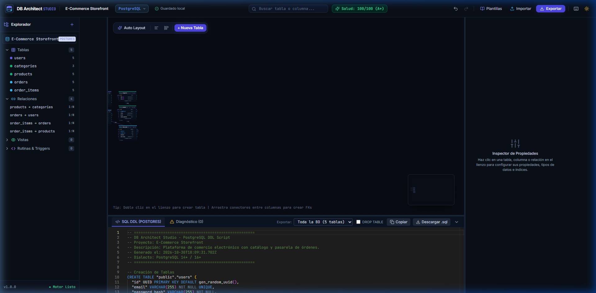
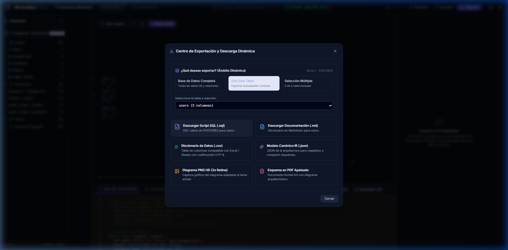
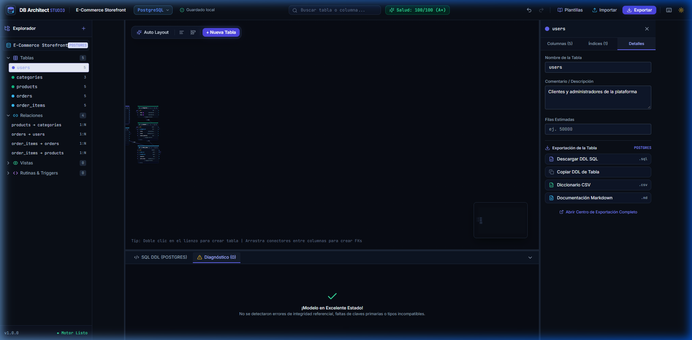
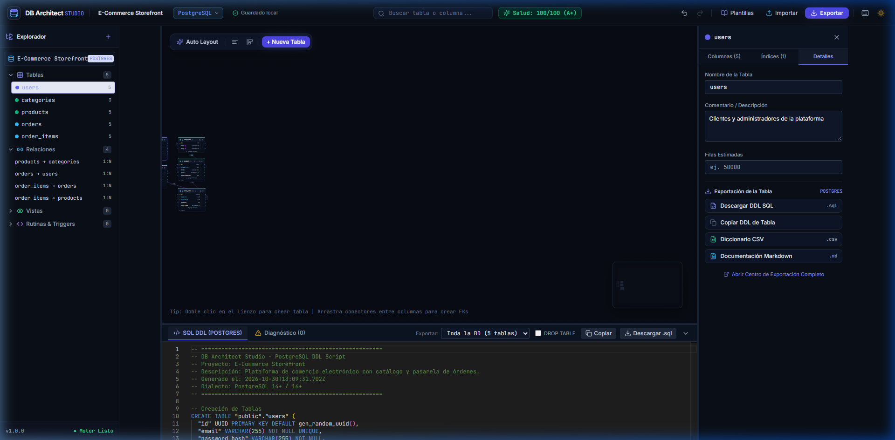
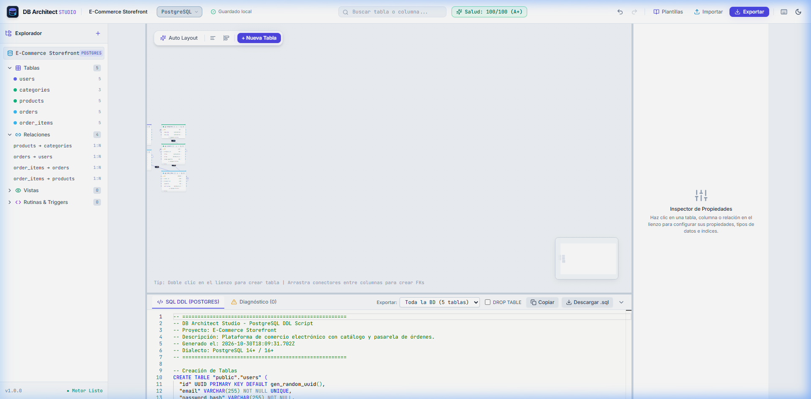

# Manual de Usuario de DB Architect Studio

**DB Architect Studio** es una plataforma profesional de ingeniería visual, diseño, documentación y administración de bases de datos relacionales. Este manual detalla todas las herramientas y flujos de trabajo disponibles en la aplicación.

---

## 📑 Tabla de Contenidos

1. [Visión General de la Interfaz](#1-visión-general-de-la-interfaz)
2. [Gestión y Diseño de Tablas](#2-gestión-y-diseño-de-tablas)
3. [Trazado y Edición de Relaciones](#3-trazado-y-edición-de-relaciones)
4. [Centro de Exportación Dinámica y Granular](#4-centro-de-exportación-dinámica-y-granular)
5. [Acciones Rápidas de Exportación Individual](#5-acciones-rápidas-de-exportación-individual)
6. [Analizador de Salud y Health Score (0 a 100)](#6-analizador-de-salud-y-health-score-0-a-100)
7. [Editor SQL Monaco en Tiempo Real](#7-editor-sql-monaco-en-tiempo-real)
8. [Ingeniería Inversa (Parser SQL DDL)](#8-ingeniería-inversa-parser-sql-ddl)
9. [Biblioteca de Plantillas Preconfiguradas](#9-biblioteca-de-plantillas-preconfiguradas)
10. [Temas: Modo Oscuro y Modo Claro](#10-temas-modo-oscuro-y-modo-claro)

---

## 1. Visión General de la Interfaz

La interfaz está diseñada con una distribución de paneles de alta productividad inspirada en herramientas modernas de ingeniería:



1. **Barra Superior (Header):**
   - **Botón "Nuevo" (`FilePlus`):** Permite inicializar un proyecto desde cero con nombre personalizado, descripción general del dominio, selección de dialecto y elección entre lienzo en blanco o entidad base de usuarios.
   - **Selector de Motor Relacional:** Cambia en cualquier momento entre **PostgreSQL**, **MySQL**, **SQLite**, **Microsoft SQL Server (T-SQL)** y **Oracle Database (PL/SQL)**.
   - **Nombre de Proyecto:** Editable con doble clic o desde el modal de creación.
   - **Píldora de Salud (Health Score):** Visualiza la calificación (ej. `100/100 A+`) y abre el diagnóstico con un clic.
   - **Controles de Deshacer/Rehacer:** Pila de historial inmutable (`Ctrl+Z`, `Ctrl+Y`).
   - **Botones de Acción:** Acceso a Nuevo Proyecto, Plantillas, Importar SQL, Exportar, Atajos y selector de Tema Claro/Oscuro.
2. **Explorador Lateral Izquierdo (Sidebar):**
   - Árbol jerárquico de esquemas, tablas y relaciones.
   - Búsqueda en tiempo real de tablas y columnas.
   - Botón de descarga rápida de DDL al pasar el cursor sobre cualquier tabla.
3. **Lienzo Infinito (Canvas):**
   - Visualización interactiva a 60 FPS con zoom inteligente y paneo ilimitado.
   - Barra flotante de alineación geométrica y auto-organización con un clic.
4. **Inspector Lateral Derecho (Inspector):**
   - Configuración a fondo de propiedades de tablas, columnas, tipos de datos, índices personalizados y reglas de relación.
5. **Panel Inferior (Bottom Panel):**
   - **Editor SQL Monaco:** Visualización en tiempo real del script DDL generado con resaltado de sintaxis nativo.
   - **Consola de Diagnóstico:** Lista de advertencias e inconsistencias con botones de **Auto-Corrección (Auto-Fix)**.

---

## 2. Gestión y Diseño de Tablas

### Crear una Nueva Tabla
- **Método 1:** Haz **doble clic** en cualquier área vacía del lienzo.
- **Método 2:** Haz clic en el botón **`+`** en la sección de tablas del Explorador Izquierdo.

### Anatomía del Nodo de Tabla
Cada tabla en el lienzo es un componente visual interactivo:
- **Barra de Color de Dominio:** Asigna colores representativos (Índigo, Cielo, Esmeralda, Ámbar, Rosa, Púrpura, Pizarra) para agrupar módulos del negocio (ej. usuarios, facturación, logística).
- **Nombre de Tabla:** Haz doble clic sobre el nombre para renombrarlo en línea.
- **Acciones en Cabecera:**
  - 📥 **Descargar:** Exporta inmediatamente el archivo `.sql` de esa tabla.
  - 🔽 **Colapsar:** Oculta o despliega la lista de columnas para diagramas densos.
  - 📋 **Duplicar:** Clona la tabla con todas sus columnas.
  - 🗑️ **Eliminar:** Borra la tabla y desvincula sus relaciones dependientes.

### Configurar Columnas
Al seleccionar una tabla, el Inspector lateral derecho te permite:
- **Agregar / Eliminar Columnas:** Botón `+ Agregar Columna`.
- **Tipo de Dato Canónico:** Elige entre enteros (`INT`, `BIGINT`), textos (`VARCHAR`, `TEXT`), temporales (`TIMESTAMP`, `DATE`), booleanos o identificadores (`UUID`).
- **Restricciones y Modificadores:**
  - 🔑 **Clave Primaria (PK):** Marca la columna como identificador único principal.
  - ⚡ **Auto-Incremental:** Configura `SERIAL`/`BIGSERIAL` en PostgreSQL o `AUTO_INCREMENT` en MySQL.
  - ❗ **No Nulo (NOT NULL):** Declara obligatoriedad del dato.
  - 🎯 **Único (UNIQUE):** Evita registros duplicados.
  - 📝 **Valor por Defecto:** Define expresiones SQL como `CURRENT_TIMESTAMP`, `'activo'` o `0`.


---

## 3. Trazado y Edición de Relaciones

Crear una relación entre tablas es tan simple como conectar dos puntos:

1. **Trazar una Clave Foránea (FK):**
   - Ubica la columna en la tabla de origen que contendrá la clave foránea.
   - Arrastra desde la **manija circular azul derecha** de esa columna hacia la **manija circular morada izquierda** de la columna de destino (por ejemplo: arrastra de `orders.user_id` hacia `users.id`).
2. **Propiedades de la Relación:**
   - Haz clic sobre la línea de conexión para abrir el Inspector de Relaciones.
   - **Cardinalidad:** Selecciona entre **1:N (Uno a Muchos)**, **1:1 (Uno a Uno)** o **N:M (Muchos a Muchos)**.
   - **Tipo de Relación:** Marca *"Relación Identificadora"* para línea continua o desmárcala para línea discontinua.
   - **Reglas Referenciales:** Configura el comportamiento de integridad referencial:
     - `ON DELETE`: `CASCADE`, `SET NULL`, `RESTRICT`, `NO ACTION`.
     - `ON UPDATE`: `CASCADE`, `SET NULL`, `RESTRICT`, `NO ACTION`.

---

## 4. Centro de Exportación Dinámica y Granular

DB Architect Studio te permite trabajar de manera **totalmente no estática**: puedes exportar **toda la base de datos**, **una sola tabla** o **un grupo personalizado de tablas**, en múltiples formatos según tus necesidades.

Para abrir el modal, haz clic en el botón **Exportar** de la barra superior:



### Selector de Ámbito (Scope)
1. 🌐 **Base de Datos Completa:**  
   Exporta el proyecto entero: todas las tablas, esquemas, claves foráneas, comentarios e índices ordenados topológicamente.
2. 📄 **Una Sola Tabla:**  
   Menú desplegable para seleccionar una única entidad (ej. `users`, `products`). El sistema generará el archivo con el nombre exacto de dicha tabla.
3. 📑 **Selección Múltiple:**  
   Lista de casillas de verificación para marcar cualquier combinación de tablas (por ejemplo, exportar solo `orders` y `order_items`).

### Formatos Disponibles
- **Script SQL (.sql):** DDL nativo optimizado para el motor seleccionado (`PostgreSQL`, `MySQL` o `SQLite`).
- **Documentación Markdown (.md):** Diccionario técnico en Markdown con tablas, tipos, nulos, descripciones y relaciones, ideal para repositorios de GitHub o Notion.
- **Diccionario CSV (.csv):** Archivo delimitado por comas con codificación **UTF-8 con BOM**, compatible nativamente con Microsoft Excel y Google Sheets.
- **Modelo Canónico IR (.json):** Respaldo completo de la estructura relacional para compartir esquemas o importarlos en otros entornos.
- **Diagrama en PNG HD (2x Retina):** Captura gráfica de alta definición con fondo adaptado al tema actual.
- **Esquema en PDF Apaisado:** Documento formal en formato A3 con encabezado de arquitectura.

---

## 5. Acciones Rápidas de Exportación Individual

Si necesitas el código de una sola tabla sin tener que abrir el modal general:

1. **Desde la cabecera de la tabla en el lienzo:**  
   Haz clic en el icono **Descargar** (<svg width="12" height="12" viewBox="0 0 24 24" fill="none" stroke="currentColor" stroke-width="2" style="display:inline"><path d="M21 15v4a2 2 0 0 1-2 2H5a2 2 0 0 1-2-2v-4"/><polyline points="7 10 12 15 17 10"/><line x1="12" y1="15" x2="12" y2="3"/></svg>) para descargar su DDL inmediatamente.
2. **Desde la pestaña "Detalles" del Inspector:**  
   Usa los botones directos:
   - *Descargar DDL SQL (.sql)*
   - *Copiar DDL de Tabla* (copia al portapapeles)
   - *Diccionario CSV (.csv)*
   - *Documentación Markdown (.md)*
3. **Desde el Explorador (Sidebar):**  
   Pasa el cursor sobre la tabla deseada en la lista y pulsa el icono de descarga.
4. **Desde el Panel Inferior de SQL:**  
   En el selector *"Exportar:"*, cambia de *"Toda la BD"* a la tabla deseada para ver su código en el editor Monaco y descargarlo con el botón *"Descargar .sql"*.

---

## 6. Analizador de Salud y Health Score (0 a 100)

En la barra superior verás en todo momento un indicador de puntuación de salud de tu modelo. Al hacer clic en él o en la pestaña **Diagnóstico** del panel inferior, se abrirá la auditoría en tiempo real:



### Reglas Auditadas:
- ❌ **Tablas sin Clave Primaria (Error Crítico):** Penaliza 15 puntos.
- ⚠️ **Claves Foráneas sin Índice (Advertencia de Rendimiento):** Detecta relaciones que provocarían *full table scans* en consultas JOIN.
- ⚠️ **Incompatibilidad de Tipos:** Detecta si una columna foránea tiene un tipo distinto a la clave primaria referenciada (ej. `INT` vs `BIGINT` o `UUID`).
- ⚡ **Botón Auto-Corregir (Auto-Fix):** Corrige el problema en 1 solo clic agregando automáticamente la columna `id` o generando el índice B-TREE correspondiente.

---

## 7. Editor SQL Monaco en Tiempo Real

El panel inferior incluye el editor de código **Monaco** (el motor de VS Code):



- **Actualización Reactiva:** Cada cambio en el lienzo (crear tabla, añadir columna, trazar relación) actualiza el DDL al milisegundo.
- **Topological Sorting:** Las tablas maestras se generan antes que las tablas hijas para asegurar que no ocurran errores de dependencia al ejecutar el script en tu base de datos.
- **DROP TABLE opcional:** Activa o desactiva la directiva `DROP TABLE IF EXISTS` según requieras scripts idempotentes.
- **Botón Copiar:** Copia el DDL completo al portapapeles con confirmación visual.

---

## 8. Ingeniería Inversa (Parser SQL DDL)

¿Ya tienes una base de datos existente y quieres verla gráficamente?

1. Haz clic en el botón **Importar SQL** en la barra superior.
2. Pega tu script DDL de creación de tablas o sube un archivo `.sql`.
3. El parser analizará automáticamente las sentencias `CREATE TABLE` y `ALTER TABLE ADD CONSTRAINT`, extraerá columnas, tipos de datos, claves primarias y relaciones, y las organizará en una cuadrícula en el lienzo.

---

## 9. Biblioteca de Plantillas Preconfiguradas

Haz clic en el botón **Plantillas** para cargar arquitecturas estándar de la industria listas para producción:
- 🛒 **E-Commerce Platform:** Catálogo de productos, categorías, usuarios, órdenes y líneas de pedido.
- 🛡️ **RBAC Authentication:** Control de acceso basado en roles con usuarios, roles y tabla intermedia N:M.
- 💼 **SaaS CRM Pipeline:** Gestión de empresas, contactos comerciales y acuerdos (*deals*).

---

## 10. Temas: Modo Oscuro y Modo Claro

La aplicación cuenta con soporte nativo completo para **Dark Mode** y **Light Mode**:



Haz clic en el icono del sol/luna en la esquina superior derecha para alternar entre el tema oscuro de alta inmersión y el tema claro optimizado para presentaciones y documentación. Tu preferencia se guarda automáticamente en `localStorage`.

---

## 11. Motores SQL y Encabezados Descriptivos de Auditoría

DB Architect Studio soporta la generación de scripts DDL profesionales para **5 motores relacionales líderes**:

| Motor / Dialecto | Identificadores | Tipos Clave | Comentarios Nativos | Claves Foráneas |
| :--- | :--- | :--- | :--- | :--- |
| **PostgreSQL (15/16+)** | `"tabla"."columna"` | SERIAL, UUID, JSONB | `COMMENT ON TABLE/COLUMN` | `ALTER TABLE ADD CONSTRAINT` |
| **MySQL (8.0+ / MariaDB)** | `` `tabla`.`columna` `` | AUTO_INCREMENT, utf8mb4 | `COMMENT '...'` inline | `ALTER TABLE ADD CONSTRAINT` |
| **SQLite 3** | `"tabla"."columna"` | INTEGER AUTOINCREMENT | Bloques de comentario `/* */` | Inline en `CREATE TABLE` |
| **Microsoft SQL Server** | `[dbo].[tabla].[columna]` | IDENTITY(1,1), NVARCHAR | `sys.sp_addextendedproperty` | `WITH CHECK ADD CONSTRAINT` |
| **Oracle Database** | `"TABLA"."COLUMNA"` | GENERATED AS IDENTITY, NUMBER | `COMMENT ON TABLE/COLUMN` | `ALTER TABLE ADD CONSTRAINT` |

### Estructura de Encabezados y Bloques de Comentarios en SQL

Todos los scripts generados incorporan metadatos y descriptores de auditoría:

```sql
-- ======================================================
-- DB Architect Studio - Script SQL DDL de [Dialecto]
-- Proyecto: [Nombre del Proyecto]
-- Descripción: [Descripción del Proyecto y Dominio]
-- Generado el: 2026-11-02T19:11:01.027Z
-- Dialecto: [Dialecto y Versión]
-- ======================================================

-- ======================================================
-- Tabla: [esquema].[tabla]
-- Descripción: [Propósito de la entidad en el negocio]
-- Columnas: 5 | Clave Primaria: [id]
-- ======================================================
CREATE TABLE ... (
   ...
);
```

---

## 9. Gestión de Cambios sin Guardar y Prevención de Pérdida de Datos

DB Architect Studio implementa un sistema robusto de auditoría de estado para prevenir la pérdida involuntaria de trabajo tanto en la versión web como en la aplicación de escritorio:

1. **Indicador Visual de Estado en Tiempo Real:**
   - **Guardado (Verde):** El proyecto actual coincide con la última versión respaldada.
   - **Guardar cambios (Ámbar parpadeante):** El lienzo tiene adiciones, movimientos o relaciones sin guardar.

2. **Guardado Dual (Local y en Disco) con Menú Desplegable:**
   - **Guardado en Navegador (`Ctrl + S`):** Pulsa directamente el botón principal de **Guardar** para persistir instantáneamente tu proyecto en el almacenamiento local del navegador (`localStorage`).
   - **Guardar Copia en Disco (`Ctrl + Shift + S`):** Despliega el menú lateral del botón de guardar y selecciona *"Guardar Copia en Disco"* para descargar un archivo `.dbmodel.json` independiente y seguro en tu disco duro.
   - **Abrir Proyecto desde Disco:** Permite seleccionar y restaurar en cualquier momento un archivo `.json` o `.dbmodel` guardado previamente, con confirmación previa si hay cambios pendientes.
   - **Acceso Directo al Centro de Exportación:** Enlace directo desde el menú de guardado para generar scripts SQL, documentación Markdown, PDF o diccionarios CSV.

3. **Protección al Cerrar la Pestaña o Navegador:**
   - Si intentas cerrar la pestaña, recargar la página o navegar fuera teniendo cambios sin guardar, el navegador interceptará el evento solicitando confirmación para evitar la pérdida de modificaciones.

4. **Advertencia al Crear un Nuevo Proyecto, Cargar Plantillas o Importar:**
   - Si tienes modificaciones sin guardar e intentas hacer clic en **"Nuevo"**, **"Plantillas"** o **"Importar"**, aparecerá un modal interactivo con tres opciones:
     - 💾 **Guardar y Continuar:** Guarda el proyecto actual y luego procede a crear el nuevo o cargar la plantilla.
     - 🗑️ **Descartar cambios:** Descarta las modificaciones pendientes y avanza con la acción solicitada.
     - ↩️ **Cancelar:** Aborta la operación y te mantiene en tu lienzo actual con todos tus cambios intactos.

5. **Soporte Nativo en la Versión de Escritorio (Electron):**
   - Al pulsar la `X` de la ventana o usar `Alt + F4` / `Cmd + Q`, la aplicación de escritorio despliega un cuadro de diálogo del sistema operativo: *"¿Deseas guardar los cambios antes de salir?"* permitiendo guardar y salir, salir sin guardar o cancelar.


